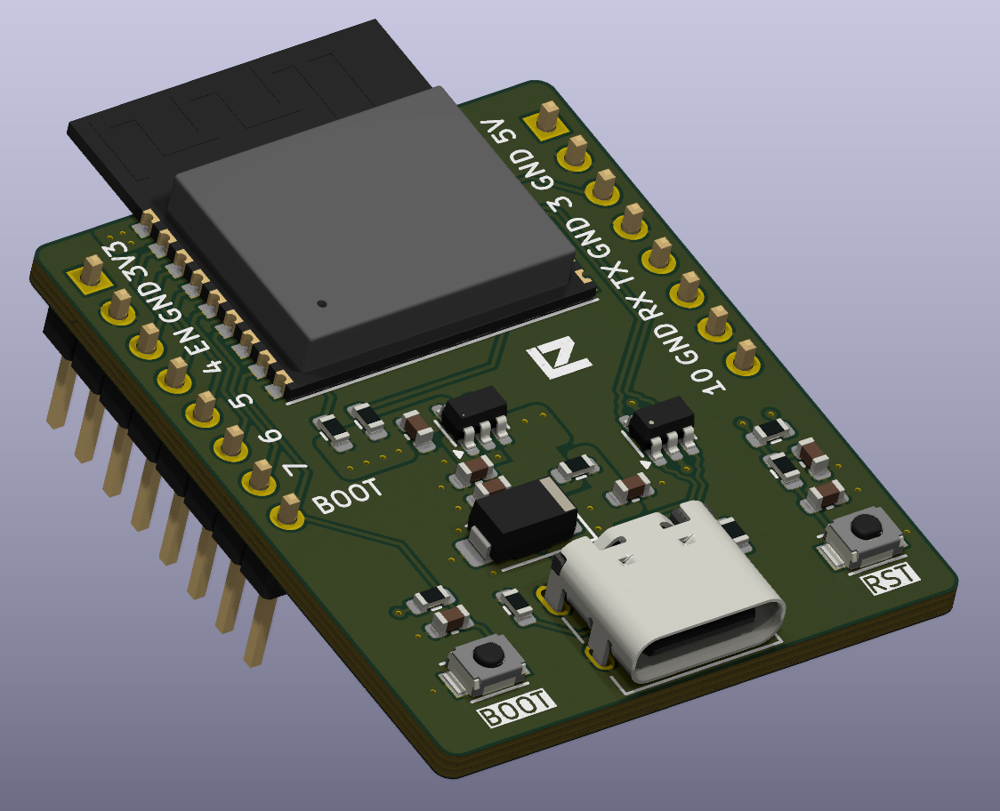
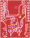
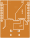
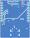

# ESP32-C3 Mini Dev Board

  

Compact 4-layer ESP32-C3 development board with native USB-C, a 3.3 V LDO, USB ESD/surge protection and breakout headers, designed in KiCad 10 and prepared for JLCPCB fabrication.

## Overview

A small, low-cost breadboard-friendly board for prototyping with the ESP32-C3 (Wi-Fi + BLE, RISC-V). It is a personal design project that covers the full hardware flow: schematic capture, a custom component library with manufacturer part numbers, 4-layer layout with controlled-impedance USB routing, DFM checks and fabrication outputs.

**Design goals**
- Power and program the board over a single USB-C cable (native USB, no USB-UART bridge)
- Protect the USB port against ESD and surge events
- Keep the board small, with the module antenna kept clear of copper
- Use parts that are in stock at the assembly house and pass the fab's DFM rules

## Key specifications

| Item | Value |
|---|---|
| Module | ESP32-C3-WROOM-02 |
| Input power | 5 V via USB-C (also on the 5V header pin) |
| 3.3 V regulator | AP2112K-3.3 LDO |
| USB protection | USBLC6-2SC6 (ESD on data lines), SMAJ5.0A TVS (VBUS) |
| Clocks | 32.768 kHz crystal (FC-135R) for the RTC |
| User controls | BOOT and RST (EN) push buttons |
| Headers | 2 × 8-pin, 2.54 mm (power, UART, GPIO) |
| Board size | 30.6 × 38.0 mm |
| Layers / thickness | 4 layers, 1.6 mm (1.5842 mm calculated stackup) |
| USB differential pair | 90 Ω target, 0.1925 mm trace / 0.18 mm gap (USB net class) |
| EDA | KiCad 10 |
| Revision | 1.0 |

## Design highlights

- **Power entry:** USB-C VBUS passes through a surge TVS (SMAJ5.0A) before the AP2112K-3.3 LDO. Bulk and bypass capacitors (4.7 µF, GRM188Z71C475KE21D) are placed at the regulator and module supply pins.
- **USB protection:** USBLC6-2SC6 on D+/D- for low-capacitance ESD protection, placed close to the connector.
- **Controlled-impedance USB:** D+/D- are routed as a 90 Ω differential pair on the top layer over a solid GND plane (see [PCB layout](#pcb-layout)).
- **Antenna keep-out:** the module's antenna overhangs the board edge, with no copper or components under it.
- **Boot and reset:** BOOT (GPIO9) and EN push buttons with pull-ups and debounce capacitors allow programming without external tools.
- **Manufacturability:** the layout was revised to pass the JLCDFM checks. Copper zones were resized, vias were removed from silkscreen, keep-outs were added around the soldermask-expansion rule bug, headers were moved away from the module to satisfy the THT-SMT spacing rule, and track spacing was increased.
- **Own component library:** symbols in `libs/` carry an IPN and MPN for each part, so the BOM is traceable.

## Pinout

Header pin labels follow the board silkscreen (see the render above). Check them against the schematic before wiring anything.

| Header | Pins (square pad first) |
|---|---|
| Left | 3V3, GND, EN, 4, 5, 6, 7, BOOT |
| Right | 5V, GND, 3, GND, TX, RX, GND, 10 |

Numbers are ESP32-C3 GPIO numbers.

## Schematics

Source files are in [`src/`](src):

- `esp32-mini-dev-board.kicad_sch`: root sheet and index
- `block-diagram.kicad_sch`: system block diagram
- `circuit-design.kicad_sch`: detailed circuit (USB power entry, 3.3 V LDO, module, clock, BOOT/EN, headers)

## PCB layout

| Top | Inner 1 (GND) | Inner 2 (power) | Bottom (mirrored) |
|---|---|---|---|
|  |  |  |  |

## Tools

- KiCad 10.0
- KiCad PCB Calculator (coupled microstrip) for the differential-pair impedance

## Author

Nelson Rodriguez (LENZSEG)
